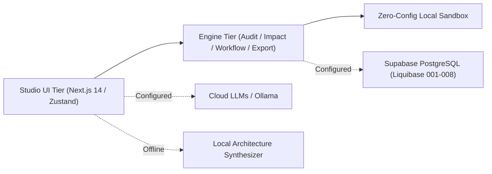

# IT Architecture & Documentation Studio 🏛️

[](https://www.typescriptlang.org/)
[](https://nextjs.org/)
[](https://tailwindcss.com/)
[](https://www.liquibase.org/)
[]()

A modern, production-ready, AI-powered **IT Architecture & Technical Documentation Studio** engineered for Enterprise Architects, Solution Architects, Tech Leads, DevOps Engineers, and Product Managers to create, customize, maintain, validate, and collaborate on technical architecture documents, visual diagrams, workflows, ADRs, and end-to-end traceability matrices.

---

## 🌟 Key Capabilities & Studio Modules

### 1. Dual-Level Document Studio (HLD & LLD)
- **High-Level Design (HLD):** System context, C4 container topology, business objectives, domain boundaries, network trust zones, and availability SLAs.
- **Low-Level Design (LLD):** Component class models, database DDL & schemas, API request/response contracts, concurrency controls, and retry algorithms.
- **Section Locking (Non-Destructive Invariant):** Lock specific sections (`isLocked`) to protect manual human edits against automated AI re-alignment or template regeneration.
- **Visual Diff Inspection:** Review AI suggestions side-by-side (`Original` vs `AI Proposed`) before applying changes.
- **Milestone Revisions:** Create named project snapshots (e.g., "Pre-CAB Baseline") and restore previous versions with one click.
- **Multi-Format Exports:** Export directly to Microsoft Word (.doc), Standalone HTML bundle, GitHub Markdown (.md), Structured YAML (.yaml), and Structured JSON (.json).

### 2. Interactive Diagram Designer (13 Diagram Types)
- **Dual-Mode Canvas:** Real-time bi-directional synchronization between an interactive drag-and-drop node canvas and Mermaid.js vector code.
- **Full Architecture Catalog:**
  1. *System Context Diagram (C4 L1)*
  2. *Container & Component Diagram (C4 L2/3)*
  3. *Deployment & Cloud Architecture (Multi-AZ AWS/GCP/Azure)*
  4. *Network & Infrastructure Diagram (VPC, Subnets, Firewalls)*
  5. *UML Class Diagram (Aggregates, Entities, Repositories)*
  6. *Sequence Diagram (Numbered sync/async lifecycles)*
  7. *Activity Diagram (Decision diamonds, parallel forks)*
  8. *Data Flow Diagram (DFD Level 1)*
  9. *Entity-Relationship Diagram (ERD with Crow's foot notation)*
  10. *BPMN-Style Business Workflow (Tasks, Gateways, Events)*
  11. *CI/CD Pipeline Diagram (Lint, Test, Scan, Deploy)*
  12. *Integration & Event-Flow Diagram (Kafka, EventBridge, DLQ)*
  13. *State Machine Diagram (Guards, timeouts, terminal states)*
- **1-Click Document Embedding:** Embed active diagrams straight into any document section.

### 3. Architecture Workflow Designer
- **Modeling vs Execution Separation:** Safe visual design of mission-critical engineering pipelines (Disaster Recovery failovers, deployment canary gates, CAB change approvals) without executing untrusted shell scripts.
- **DAG Validation Engine:** Detects orphan nodes, dead-end branches, missing triggers, and loops.
- **Simulation Trace:** Simulates deterministic task traversal with elapsed durations and retry budgets.

### 4. Requirements Registry & Traceability Matrix
- **MoSCoW Prioritization:** Business (BR), Functional (FR), and Non-Functional (NFR) requirements tracking.
- **Change-Impact Engine:** When requirements or scale changes (e.g. from 1,000 to 50,000 RPS), the engine automatically detects affected sections and diagrams, and proposes concrete remediation patches.
- **Bi-Directional Traceability:** Live matrix connecting requirements to sections, diagrams, and ADRs.

### 5. ADR Governance Manager
- **MADR-Compliant Records:** Capture problem context, options considered, trade-offs, and compliance tags.
- **Supersession Lifecycle:** Formal linking when decisions are superseded by newer architectural standards.

### 6. Architecture Quality Review & Audit Engine
- **Deterministic Static Audit:** 10 core checks evaluating Single Points of Failure (SPOFs), encryption at rest/transit, financial transaction idempotency, DLQs, exponential backoff jitter, and RTO/RPO metrics.
- **Architecture Score (0-100):** Visual health indicator with severity classification.
- **1-Click Remediation:** Injects recommended security and reliability patches directly into document sections.

---

## 🏗️ System Architecture & Dual-Mode Operations

The studio is designed for zero-friction adoption:
1. **Zero-Config Standalone Mode (Default):** Runs 100% offline without remote database connections or paid AI API keys. Utilizes an in-memory database (`LocalSandboxDatabase`) with browser `localStorage` synchronization and a deterministic local architecture synthesis engine.
2. **Enterprise Cloud Mode:** Integrates seamlessly with Supabase PostgreSQL (managed via Liquibase changesets 001–008) and leading AI models (OpenAI GPT-4o, Google Gemini 1.5 Pro, Anthropic Claude 3.5 Sonnet, or local Ollama).



---

## 🚦 Getting Started Locally

### Prerequisites
- Node.js >= 18.16.0
- npm >= 9.x

### Installation & Run
```bash
# 1. Clone the repository
git clone https://github.com/ravi-kundu7284/it-common-doc-arch-stdio-app.git
cd it-common-doc-arch-stdio-app

# 2. Install dependencies
npm install

# 3. Start local development server (Runs in zero-config offline sandbox)
npm run dev
```

Visit [http://localhost:3000](http://localhost:3000) to start designing.

### Automated Test Suite
```bash
# Run all unit, integration, and engine test suites (20 tests across 6 suites)
npm test
```

### Production Build
```bash
npm run build
npm start
```

---

## 📚 Documentation Index

Comprehensive architectural guides and specifications are available in the [`docs/`](./docs) directory:

- [**UPGRADE_ASSESSMENT.md**](./docs/UPGRADE_ASSESSMENT.md) — Baseline audit, technical debt, and 5-phase migration roadmap.
- [**ARCHITECTURE.md**](./docs/ARCHITECTURE.md) — System architecture, subsystem breakdown, and persistence strategy.
- [**HLD_TEMPLATE.md**](./docs/HLD_TEMPLATE.md) — Reusable enterprise High-Level Design template.
- [**LLD_TEMPLATE.md**](./docs/LLD_TEMPLATE.md) — Reusable enterprise Low-Level Design template.
- [**AI_FEATURES.md**](./docs/AI_FEATURES.md) — Multi-provider setup, prompt safety, and fallback engine.
- [**DIAGRAMS_AND_WORKFLOWS.md**](./docs/DIAGRAMS_AND_WORKFLOWS.md) — 13 diagram catalog, visual canvas, and workflow validation.
- [**API.md**](./docs/API.md) — Complete REST API OpenAPI reference.
- [**SECURITY.md**](./docs/SECURITY.md) — Threat model, PBKDF2 hashing, RLS, and privacy guardrails.
- [**DEVELOPMENT.md**](./docs/DEVELOPMENT.md) — Local developer setup, test runner, and extension guide.
- [**DEPLOYMENT.md**](./docs/DEPLOYMENT.md) — Production Docker, Kubernetes, and Liquibase migrations.
- [**CHANGELOG.md**](./CHANGELOG.md) — Full upgrade changelog (v2.0.0).

---

## 📄 License
MIT License. Built for enterprise software architects and engineering teams.
