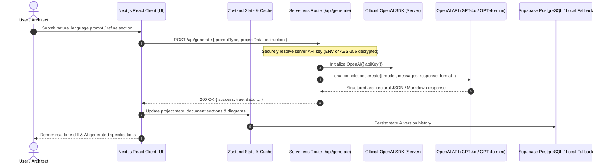

# AI Integration & Architecture Audit Report

**Repository:** `https://github.com/ravi-kundu7284/it-common-doc-arch-stdio-app`  
**Audit Date:** October 2026  
**Auditor:** Antigravity AI Engineering Team  
**Status:** Findings Documented & Remediation In-Progress  

---

## 1. Executive Summary

An in-depth architectural and code inspection was conducted across the **IT Architecture & Documentation Studio** repository to evaluate its OpenAI API integration, end-to-end request lifecycle, and data generation mechanisms.

The audit discovered that while the application provides an enterprise-ready UI and rich document data structures, several AI capabilities were implemented as client-side heuristics, mock timers (`setTimeout`), and static template interpolations. Furthermore, when the OpenAI API key was missing or invalid, the backend endpoint silently returned static markdown masquerading as AI-generated responses rather than surfacing actionable errors to the user.

This document details the audit findings, pinpoints root causes, and defines the remediation architecture to transform the application into an authentic, production-ready, OpenAI-powered architecture studio.

---

## 2. Request Lifecycle Analysis

### Intended Architecture

### Actual Discovered State Before Audit
1. **Intake Analysis:** In `src/components/requirements-wizard.tsx`, `handleRunAiAnalysis` executed a `setTimeout(..., 700)` calling a local deterministic function `analyzeRequirementText` in `src/lib/ai-analyzer.ts`. No HTTP request was dispatched to any backend or AI provider.
2. **Section Refinement:** In `src/app/api/generate/route.ts`, when `apiKey` was missing or invalid, lines 170–197 executed a "High-Fidelity Built-in Engine Fallback" that returned hardcoded markdown strings based on basic regex matches (e.g. `instrLower.includes("sequence diagram")`). This gave the illusion of AI generation without actual inference.
3. **Document Set Synthesis:** `generateFullDocumentSet` in `src/lib/doc-generator.ts` generated 17 core documents solely using static string interpolation templates.
4. **Missing Official SDK:** The codebase used `@ai-sdk/openai` (`^0.0.33`), but lacked the official `openai` Node.js SDK (`npm install openai`), preventing native use of structured JSON schema outputs, streaming, and granular error handling.
5. **Character Encoding (Mojibake):** File encodings in some UI components resulted in corrupt character glyphs (e.g., `🵋ŢIJ`) rendering on screen instead of clean icons or typography.

---

## 3. Detailed Audit Findings & Root Causes

| ID | Component | Discovered Flaw | Root Cause | Impact |
| :--- | :--- | :--- | :--- | :--- |
| **AUD-01** | `package.json` | Missing official `openai` SDK | Only experimental wrapper `@ai-sdk/openai` was installed | Inability to use standard `openai` SDK methods (`OpenAI`, `chat.completions`, `toFile`, etc.) |
| **AUD-02** | `src/app/api/generate/route.ts` | Silent fallback to hardcoded mock text on missing API key | Silent fallback block at lines 170–197 returning `200 OK` with static markdown | Users receive canned responses without realizing the API key is unconfigured |
| **AUD-03** | `src/components/requirements-wizard.tsx` | Client-side `setTimeout` simulation of AI requirements analysis | `handleRunAiAnalysis` invoked local `analyzeRequirementText` via `setTimeout(..., 700)` | No real AI synthesis of free-form natural language prompts |
| **AUD-04** | `src/components/quality-audit-view.tsx` | Simulated audit delays without AI validation | `handleRunAudit` used `setTimeout(..., 400)` with deterministic rules only | Misses domain-specific threat modeling and deep semantic architecture validation |
| **AUD-05** | `src/lib/doc-generator.ts` | Static template documents labeled as generated | Entire 17-document suite generated purely via string interpolation | Architectural documents lack dynamic AI insights tailored to specific domain prompts |
| **AUD-06** | UI Components | Mojibake / garbled UTF-8 characters on buttons & cards | Corrupted multi-byte emoji encoding in source files | Visual artifacts degrading user experience |
| **AUD-07** | `.env.local` | Missing `OPENAI_API_KEY` definition | Environment template lacked clear guidance on server key resolution | Fallback behavior was triggered by default |

---

## 4. Remediation Plan

### Phase 1: Official OpenAI SDK Installation & Configuration
- [x] Install official `openai` package (`openai@^4.104.0`).
- [ ] Configure `src/lib/openai.ts` to manage server-side `OpenAI` client instantiation with configurable models (`gpt-4o`, `gpt-4o-mini`), custom base URLs (compatible with Azure OpenAI / enterprise proxies), timeout limits, and retry policies.
- [ ] Ensure API keys are strictly server-side (`process.env.OPENAI_API_KEY` or AES-256-GCM decrypted keys from Supabase). Never expose raw keys in client payloads or browser storage.

### Phase 2: Actionable Error Handling Protocol
- [ ] Update `/api/generate` to strictly validate API keys. If neither server environment nor decrypted user key is present:
  - Return HTTP 400 with `{ success: false, error: "OpenAI API key is missing. Please configure OPENAI_API_KEY in .env.local or via Settings.", code: "MISSING_API_KEY" }`.
- [ ] If OpenAI returns a 401 Unauthorized or 429 Quota Exceeded error:
  - Surface actionable error codes (`INVALID_API_KEY`, `QUOTA_EXCEEDED`, `RATE_LIMITED`) with human-readable resolution instructions.
- [ ] In UI (`requirements-wizard.tsx`, `document-studio.tsx`, `quality-audit-view.tsx`):
  - Catch API errors and display an interactive alert banner with a 1-click shortcut to open the `SettingsModal` to configure keys.

### Phase 3: True AI Requirements Intake & Decomposition
- [ ] Implement `promptType: "analyze_requirements"` in `/api/generate` using OpenAI Chat Completions with JSON response format (`response_format: { type: "json_object" }`).
- [ ] Prompt extracts:
  - Project title, domain, recommended architectural pattern, tech stack.
  - Granular functional requirements (with priority, ID, acceptance criteria).
  - Non-functional requirements (p99 latency, RPS throughput, availability SLA, compliance).
  - Clarifying architectural questions, assumptions, constraints, and dependencies.
  - Recommended document types out of the 17-document architecture suite.
- [ ] Connect `RequirementsWizard.tsx` to call `/api/generate` with real OpenAI inference, while preserving an optional manual "Offline Template Mode" toggle for development/demo.

### Phase 4: Dynamic AI Document & Section Generation
- [ ] Implement `promptType: "generate_document"` and `promptType: "refine_section"` in `/api/generate`.
- [ ] Dynamic generation leverages the project's domain, scale parameters, and architecture patterns to create comprehensive HLD, LLD, ADRs, database DDL, API contracts, and Mermaid diagrams.
- [ ] Side-by-side diff preview (`DocumentStudio`) shows exact AI revisions before applying.

### Phase 5: AI Architecture Quality & Threat Audit
- [ ] Add `promptType: "audit_architecture"` to `/api/generate`.
- [ ] OpenAI analyzes the architecture against STRIDE threat modeling, single points of failure (SPOF), CAP theorem trade-offs, and cost-scaling traps, producing actionable findings with remediation patches.

### Phase 6: Encoding Cleanup & Automated Verification
- [ ] Fix all garbled characters / mojibake in UI source files.
- [ ] Run test suite (`npm test`), verify TypeScript typing (`npx tsc --noEmit`), and execute production build (`npm run build`).

