# IT Architecture & Documentation Studio — System Architecture

## 1. Executive Summary

The **IT Architecture & Documentation Studio** is an enterprise-grade platform designed for enterprise architects, solution architects, tech leads, DevOps engineers, and product managers. It transforms natural language requirements, architectural choices, and domain constraints into structured, publication-ready High-Level Design (HLD) and Low-Level Design (LLD) specifications, visual architecture diagrams, process workflows, Architecture Decision Records (ADRs), and end-to-end requirement traceability matrices.

The studio operates on a **dual-mode operational philosophy**:
1. **Zero-Config Standalone Mode:** Fully operational offline and out-of-the-box without requiring third-party cloud accounts, database instances, or paid AI API keys. Built-in local synthesis engines and an in-memory sandbox database provide full functionality.
2. **Enterprise Cloud Mode:** Integrates seamlessly with Supabase PostgreSQL (managed via Liquibase change management) and major LLM providers (OpenAI GPT-4, Google Gemini Pro, Anthropic Claude, and local Ollama instances) for team collaboration and advanced generative intelligence.

---

## 2. High-Level Architecture Diagram

```mermaid
graph TD
    subgraph Client["Client Tier (Next.js 14 App Router / React 18)"]
        UI_Nav["Top Navigation Bar"]
        UI_Intake["Architectural Intake Wizard"]
        UI_Doc["Document Studio (Split / Live Preview)"]
        UI_Diagram["Interactive Diagram Designer (13 Types)"]
        UI_Workflow["Architecture Workflow Designer"]
        UI_Req["Requirements & Traceability Matrix"]
        UI_ADR["ADR Governance Manager"]
        UI_Audit["Architecture Quality Audit"]
        Zustand["Global State & Draft Store (Zustand)"]
    end

    subgraph Service["Application & Engine Layer (TypeScript)"]
        AuditEngine["Architecture Audit Engine (SPOF, Security, Resilience)"]
        ImpactEngine["Change Impact & Traceability Engine"]
        WorkflowEngine["Workflow DAG Validation & Simulation Engine"]
        DiagramCatalog["Diagram Catalog & Mermaid Vector Synthesizer"]
        ExportEngine["Export Engine (HTML, Word DOCX, MD, YAML, JSON)"]
        AIFallback["Local Architecture Synthesis Engine"]
    end

    subgraph API["REST API Layer (/api/*)"]
        API_Auth["API Auth & Security Guard"]
        API_Projects["/api/projects"]
        API_Revisions["/api/documents/revisions"]
        API_Diagrams["/api/diagrams"]
        API_Workflows["/api/workflows & /api/workflows/validate"]
        API_Requirements["/api/requirements & /api/requirements/impact"]
        API_ADRs["/api/adrs"]
        API_AuditRoute["/api/quality-audit"]
        API_ExportRoute["/api/export"]
        API_Gen["/api/generate"]
    end

    subgraph Persistence["Persistence & Data Tier"]
        LocalSandbox["In-Memory Local Sandbox (Zero-Config DB)"]
        SupabaseDB["Supabase PostgreSQL (Enterprise Cloud)"]
        Liquibase["Liquibase Versioned Changesets (001-008)"]
    end

    subgraph External["External AI Providers (Configurable)"]
        OpenAI["OpenAI (GPT-4o)"]
        Gemini["Google Gemini 1.5 Pro"]
        Claude["Anthropic Claude 3.5 Sonnet"]
        Ollama["Local Ollama LLM"]
    end

    UI_Nav --> Zustand
    UI_Intake --> Zustand
    UI_Doc --> Zustand
    UI_Diagram --> Zustand
    UI_Workflow --> Zustand
    UI_Req --> Zustand
    UI_ADR --> Zustand
    UI_Audit --> Zustand

    Zustand --> AuditEngine
    Zustand --> ImpactEngine
    Zustand --> WorkflowEngine
    Zustand --> ExportEngine

    UI_Doc --> API_Revisions
    UI_Diagram --> API_Diagrams
    UI_Workflow --> API_Workflows
    UI_Req --> API_Requirements
    UI_ADR --> API_ADRs
    UI_Audit --> API_AuditRoute
    UI_Doc --> API_Gen

    API_Gen --> OpenAI
    API_Gen --> Gemini
    API_Gen --> Claude
    API_Gen --> Ollama
    API_Gen -.->|Fallback when no key| AIFallback

    API_Projects --> LocalSandbox
    API_Revisions --> LocalSandbox
    API_Diagrams --> LocalSandbox
    API_Workflows --> LocalSandbox
    API_Requirements --> LocalSandbox
    API_ADRs --> LocalSandbox
    API_AuditRoute --> LocalSandbox

    LocalSandbox -.->|Configured| SupabaseDB
    Liquibase --> SupabaseDB
```

---

## 3. Core Architecture Subsystems

### 3.1 Document Studio (`src/components/document-studio.tsx`)
- **Dual-Level Architecture Specifications:** Seamlessly toggles between **High-Level Design (HLD)** focusing on business context, external systems, C4 container topologies, and SLA boundaries, and **Low-Level Design (LLD)** focusing on component classes, DB schemas, API request/response payloads, and retry algorithms.
- **Section Locking (Non-Destructive AI):** Architects can lock specific sections against automated re-alignment. When template regeneration runs, locked sections retain their exact user-authored content.
- **Visual Diff Inspection:** AI section refinements present a unified side-by-side diff modal (`Original` vs `AI Proposed`) before changes are committed to the working draft.
- **Milestone Revisions:** Named snapshot creation and one-click rollback backed by `/api/documents/revisions`.

### 3.2 Interactive Diagram Designer (`src/components/diagram-designer.tsx`)
- **Hybrid Visual + Vector Editing:** Supports interactive drag-and-drop node placement on an infinite zoom/pan canvas, synchronized in real time with Mermaid.js syntax.
- **13 Architecture Diagram Types Supported:**
  1. System Context Diagram (C4 Level 1)
  2. Container & Component Diagram (C4 Level 2/3)
  3. Deployment & Cloud Architecture (AWS/GCP/Azure multi-AZ topology)
  4. Network & Infrastructure Diagram (VPC, Subnets, Firewalls, Load Balancers)
  5. UML Class Diagram (Interfaces, Aggregates, Entities)
  6. Sequence Diagram (Actor, Gateway, Microservice, Database)
  7. Activity Diagram (Decision branches, merge bars)
  8. Data Flow Diagram (DFD Level 1)
  9. Entity-Relationship Diagram (ERD with constraints)
  10. BPMN-Style Business Workflow (Tasks, Gateways, Events)
  11. CI/CD Pipeline Diagram (Lint, Test, Build, Scan, Deploy)
  12. Integration & Event-Flow Diagram (Kafka, EventBridge, Consumers)
  13. State Machine Diagram (State transitions and guards)
- **Document Embedding:** One-click insertion of diagrams into the active document section.

### 3.3 Architecture Workflow Designer (`src/components/workflow-designer.tsx`)
- **Process & Engineering Modeling:** Visual creation of end-to-end orchestration pipelines with triggers, tasks, conditional branches, approvals, and terminal states.
- **Strict Modeling vs. Execution Separation:** Adheres to enterprise security standards by validating workflow topology and simulating step transitions without executing arbitrary host commands.
- **Static Graph Validation:** Detects orphan nodes, disconnected branches, cycles without termination, and missing triggers via `src/lib/workflow-engine.ts`.
- **Simulation Trace:** Simulates deterministic task traversal with elapsed time, retry budgets, and mock step outputs.

### 3.4 Requirements Registry & Impact Engine (`src/components/requirements-registry.tsx`)
- **Categorized Requirements:** Manages Business Requirements (BR), Functional Requirements (FR), and Non-Functional Requirements (NFR) with MoSCoW prioritization.
- **Change-Impact Analysis:** When a requirement's specification or scale changes (e.g. from 1,000 RPS to 50,000 RPS), `src/lib/impact-engine.ts` scans all document sections and diagrams, identifies directly affected components, and auto-proposes concrete remediation text patches.
- **Traceability Matrix:** Real-time bi-directional matrix linking requirements to document sections, visual diagrams, and ADRs.

### 3.5 ADR Governance Manager (`src/components/adr-manager.tsx`)
- **Enterprise Decision Records:** Captures context, problem statement, options considered, decision rationale, positive/negative consequences, and compliance tags.
- **Supersession Lifecycle:** Enforces the MADR standard. When a decision is superseded, its status is updated to `superseded` and explicitly linked to the newer ADR ID.

### 3.6 Architecture Quality Review Engine (`src/components/architecture-audit.tsx`)
- **Deterministic Static Audit:** Evaluates architectural specifications against 10 critical reliability and security dimensions:
  - Single Point of Failure (SPOF) detection in high-scale systems (>5,000 RPS)
  - Encryption at rest and in transit for sensitive/regulated domains (FinTech, Healthcare)
  - Financial transaction idempotency and Dead Letter Queues (DLQ)
  - Distributed retry strategies with exponential backoff and jitter
  - Circuit breaker failure thresholds
  - Recovery Time Objective (RTO) and Recovery Point Objective (RPO) definitions
- **One-Click Remediation Injection:** Generates concrete markdown remediation patches that can be injected straight into document sections.

### 3.7 Multi-Format Export Engine (`src/lib/export-engine.ts`)
- **Microsoft Word (.doc):** Generates valid OpenXML Word documents preserving styled headings, tables, metadata callouts, and code blocks.
- **Standalone HTML (.html):** Produces a fully self-contained HTML file styled with modern CSS, embedded Mermaid rendering scripts, and complete responsive layout.
- **Markdown (.md):** Outputs clean GitHub-flavored markdown with YAML frontmatter.
- **Structured YAML (.yaml) & JSON (.json):** Exports machine-readable architecture representations suitable for CI/CD gates and Architecture-as-Code tooling.

---

## 4. Data Layer & Persistence Architecture

The studio implements a fault-tolerant repository pattern in `src/lib/supabase.ts`:

1. **LocalSandboxDatabase (Default):**
   - Automatically initializes in-memory stores for all 9 entities: `projects`, `document_sections`, `document_revisions`, `diagrams`, `workflows`, `requirements`, `requirement_trace_links`, `adrs`, and `architecture_reviews`.
   - Seeded with comprehensive enterprise reference architectures (e.g., E-Commerce Global Architecture).
   - Syncs drafts to browser `localStorage` for cross-session persistence without any remote network round-trips.

2. **Supabase PostgreSQL (Enterprise):**
   - Activated when `NEXT_PUBLIC_SUPABASE_URL` and `NEXT_PUBLIC_SUPABASE_ANON_KEY` are provided.
   - All schema changes, constraints, foreign keys, and indexes are managed via Liquibase changesets under `liquibase/changesets/001-008`.
   - Row-Level Security (RLS) policies restrict project reads, writes, and deletions to authorized owners while supporting organization-wide sharing.

---

## 5. Technology Stack Summary

| Layer | Technologies |
| :--- | :--- |
| **Framework** | Next.js 14.0.4 (App Router, Server Components & Route Handlers) |
| **Language** | TypeScript 5.3 (Strict Type Checking) |
| **Styling** | Tailwind CSS 3.3, Lucide React Icons |
| **State Management** | Zustand 4.4 (Client store with local persistence) |
| **Diagrams & Vector** | Mermaid.js 10.6, Interactive SVG Node Canvas |
| **Database & Migration** | PostgreSQL, Supabase, Liquibase XML & SQL Changesets |
| **Testing** | Node.js Test Runner (`node --test`), Custom TypeScript Loader (`scripts/ts-loader.mjs`) |
| **AI Integration** | OpenAI SDK, Google Generative AI SDK, Anthropic Claude, Ollama REST API, Local Synthesis Fallback |

