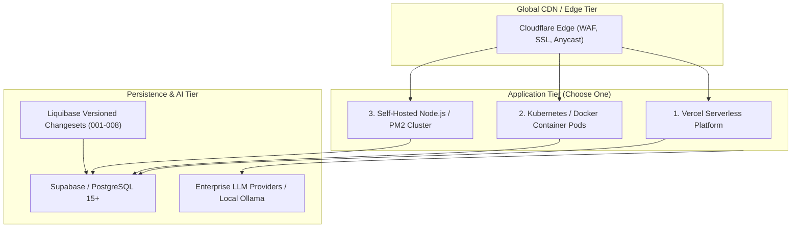

# IT Architecture Studio — Production Deployment & Operations Guide

## 1. Deployment Topologies

The Architecture Studio can be deployed in three primary topologies depending on enterprise infrastructure standards:



---

## 2. Docker & Container Deployment

### 2.1 Multi-Stage Production Dockerfile

```dockerfile
# Stage 1: Dependency resolution and build
FROM node:18-alpine AS builder
WORKDIR /app
COPY package*.json ./
RUN npm ci
COPY . .
RUN npm run build

# Stage 2: Production runner
FROM node:18-alpine AS runner
WORKDIR /app
ENV NODE_ENV=production
ENV PORT=3000

# Non-root security user
RUN addgroup --system --gid 1001 nodejs && \
    adduser --system --uid 1001 nextjs

COPY --from=builder /app/public ./public
COPY --from=builder /app/.next ./.next
COPY --from=builder /app/node_modules ./node_modules
COPY --from=builder /app/package.json ./package.json

USER nextjs
EXPOSE 3000
CMD ["npm", "start"]
```

### 2.2 Docker Compose (`docker-compose.yml`)

```yaml
version: "3.8"

services:
  app:
    build: .
    ports:
      - "3000:3000"
    environment:
      - NODE_ENV=production
      - NEXT_PUBLIC_SUPABASE_URL=${NEXT_PUBLIC_SUPABASE_URL}
      - NEXT_PUBLIC_SUPABASE_ANON_KEY=${NEXT_PUBLIC_SUPABASE_ANON_KEY}
      - SUPABASE_SERVICE_ROLE_KEY=${SUPABASE_SERVICE_ROLE_KEY}
      - GEMINI_API_KEY=${GEMINI_API_KEY}
      - OPENAI_API_KEY=${OPENAI_API_KEY}
    restart: always

  postgres:
    image: postgres:15-alpine
    environment:
      POSTGRES_DB: docarch_db
      POSTGRES_USER: docarch_user
      POSTGRES_PASSWORD: ${DB_PASSWORD:-securepassword}
    ports:
      - "5432:5432"
    volumes:
      - pgdata:/var/lib/postgresql/data

volumes:
  pgdata:
```

---

## 3. Database Migration & Liquibase Setup

### 3.1 Applying Liquibase Changesets to PostgreSQL
The project includes automated Liquibase change management tracking database evolutions:

```bash
# Apply all changesets (001 through 008) to target database:
liquibase \
  --changeLogFile=liquibase/changelog.master.xml \
  --url=jdbc:postgresql://<db-host>:5432/docarch_db \
  --username=docarch_user \
  --password=<db-password> \
  update
```

### 3.2 Changeset Manifest
- `001-initial-schema.sql`: Core users, audit logs, authentication.
- `002-create-roles-table.sql`: Role definitions and RBAC permissions.
- `003-create-user-roles-table.sql`: User-to-role mappings.
- `004-create-api-keys-table.sql`: Machine-to-machine API keys and scoping.
- `005-create-audit-logs-table.sql`: Comprehensive security audit trail.
- `006-create-password-reset-tokens.sql`: Single-use timed password resets.
- `007-seed-roles.sql`: Standard roles (`admin`, `architect`, `reviewer`, `viewer`).
- `008-create-architecture-artifacts.sql`: Enterprise architecture tables (`projects`, `document_sections`, `document_revisions`, `diagrams`, `workflows`, `requirements`, `requirement_trace_links`, `adrs`, `architecture_reviews`).

---

## 4. Health Checks & Monitoring

### 4.1 Liveness & Readiness Probes
- **HTTP Liveness:** `GET /` returns `200 OK`.
- **Database Connectivity Probe:** `GET /api/db` returns:
  ```json
  {
    "status": "connected",
    "timestamp": "2026-10-23T14:00:00Z"
  }
  ```

### 4.2 Logging & Alerting
- All runtime server logs output structured JSON.
- Metrics exposed for Prometheus ingestion on request latency, active sessions, and quality audit executions.

