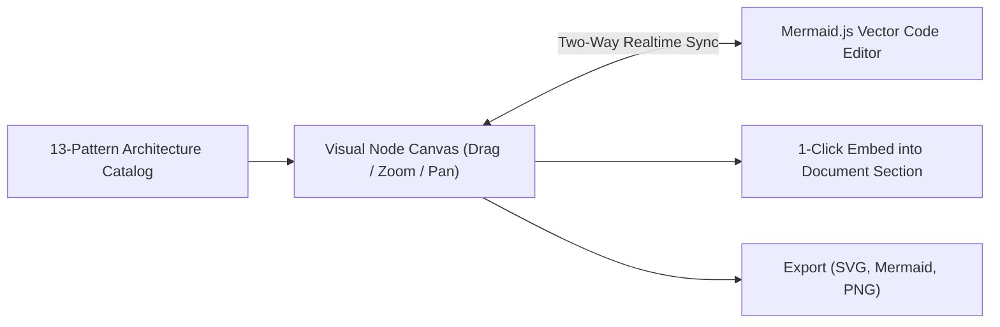
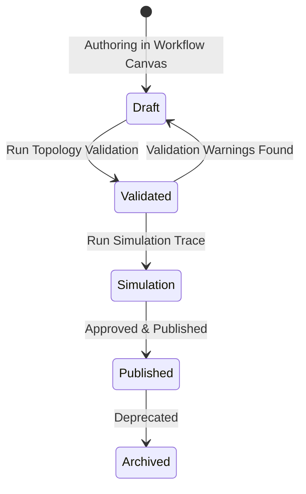

# Diagrams & Workflow Modeling Guide

## 1. Interactive Diagram Designer

The **Diagram Designer** provides a dual-mode visual workspace for authoring, editing, and versioning enterprise architectural diagrams. It seamlessly couples an interactive drag-and-drop node canvas with live Mermaid.js vector code synchronization.

---

## 2. Supported Architecture Diagram Catalog (13 Types)

The studio provides pre-configured templates and dedicated visual renderers for 13 industry-standard diagram types:

### 1. System Context Diagram (C4 Level 1)
- **Scope:** Highest-level view of the enterprise system, external user personas, and external third-party systems.
- **Key Elements:** Users, enterprise boundaries, identity providers, third-party payment/logistics APIs.

### 2. Container & Component Diagram (C4 Level 2 & 3)
- **Scope:** Decomposes the system into deployable containers (microservices, web applications, worker pools) and internal component packages.
- **Key Elements:** Ingress gateways, domain services, caching layers, and database clusters.

### 3. Deployment & Cloud Architecture
- **Scope:** Multi-Availability Zone (AZ) and multi-region infrastructure layout across AWS, GCP, or Azure.
- **Key Elements:** Cloudflare Edge, Application Load Balancers, EKS/GKE Kubernetes clusters, Aurora/Cloud Spanner clusters, S3 buckets.

### 4. Network & Infrastructure Diagram
- **Scope:** Subnet topology, VPC peering, DMZ zones, NAT gateways, Bastion hosts, and firewall security groups.
- **Key Elements:** Public subnets, private worker subnets, isolated database subnets, egress filtering.

### 5. UML Class Diagram
- **Scope:** Object-oriented domain modeling adhering to Domain-Driven Design (DDD).
- **Key Elements:** Aggregates, Entities, Value Objects, Domain Interfaces, Repositories, and Inheritance/Composition relationships.

### 6. Sequence Diagram
- **Scope:** Temporal interaction between human actors, ingress gateways, application services, caches, and databases.
- **Key Elements:** Numbered synchronous calls, asynchronous callbacks, alternative error paths, and response bodies.

### 7. Activity Diagram
- **Scope:** Algorithmic business logic flow, parallel fork/join operations, and conditional decision diamonds.
- **Key Elements:** Start state, process actions, decision nodes, synchronization bars, terminal state.

### 8. Data Flow Diagram (DFD Level 1)
- **Scope:** Progression of data assets through system processes, external entities, and persistent data stores.
- **Key Elements:** External entities, processes, data stores, data flows with labeled data schemas.

### 9. Entity-Relationship Diagram (ERD)
- **Scope:** Relational database schemas, table attributes, primary/foreign keys, and cardinality constraints.
- **Key Elements:** Crow's foot cardinality (`||--o{`), entity names, data types, unique constraints.

### 10. BPMN-Style Business Workflow
- **Scope:** Human-in-the-loop and automated enterprise workflows.
- **Key Elements:** Trigger events, user approval checkpoints, automated service tasks, exclusive gateways, timer escalations.

### 11. CI/CD Pipeline Diagram
- **Scope:** End-to-end continuous integration and deployment stages.
- **Key Elements:** Git push trigger, linting, unit tests, SAST/DAST security scanning, artifact packaging, staging deployment, canary release.

### 12. Integration & Event-Flow Diagram
- **Scope:** Asynchronous event streaming and message queuing patterns.
- **Key Elements:** Kafka topic partitions, EventBridge buses, consumer groups, dead letter queues (DLQs), CDC outbox publishers.

### 13. State Machine Diagram
- **Scope:** Lifecycle transitions of domain entities (e.g. Order, Invoice, Deployment).
- **Key Elements:** Initial state, state transitions with trigger guards, timeout transitions, terminal states.

---

## 3. Workflow Designer & Validation Engine

### 3.1 Architectural Separation: Modeling vs. Execution
The **Architecture Workflow Designer** (`src/components/workflow-designer.tsx`) strictly decouples process **modeling** from arbitrary code **execution**. It allows engineering teams to model mission-critical operational processes (e.g., Disaster Recovery Failovers, CI/CD Deployment Gates, CAB Review Workflows) with rigorous static validation without exposing the host to arbitrary code injection.

### 3.2 Graph Validation Engine (`src/lib/workflow-engine.ts`)
Before a workflow can be published or exported, the validation engine checks:
1. **Trigger Presence:** Exactly one valid trigger step (`trigger` or `event`) must exist.
2. **Terminal Reachability:** All branches must terminate in an `end` state or handled failure compensation.
3. **Dead-End Detection:** Identifies steps lacking outgoing edges.
4. **Broken References:** Detects edge pointers targeting non-existent step IDs.
5. **Cycle Safeguards:** Confirms loops contain bounded retry counters or exit conditions.

### 3.3 Simulation & Execution Trace
The built-in simulator executes the workflow model step-by-step in memory:
- Traverses directed edges based on branch conditions.
- Simulates step latency and accumulates cumulative elapsed time.
- Emulates retry budgets on simulated step failures.
- Produces a detailed simulation trace log for architectural review and compliance auditing.

