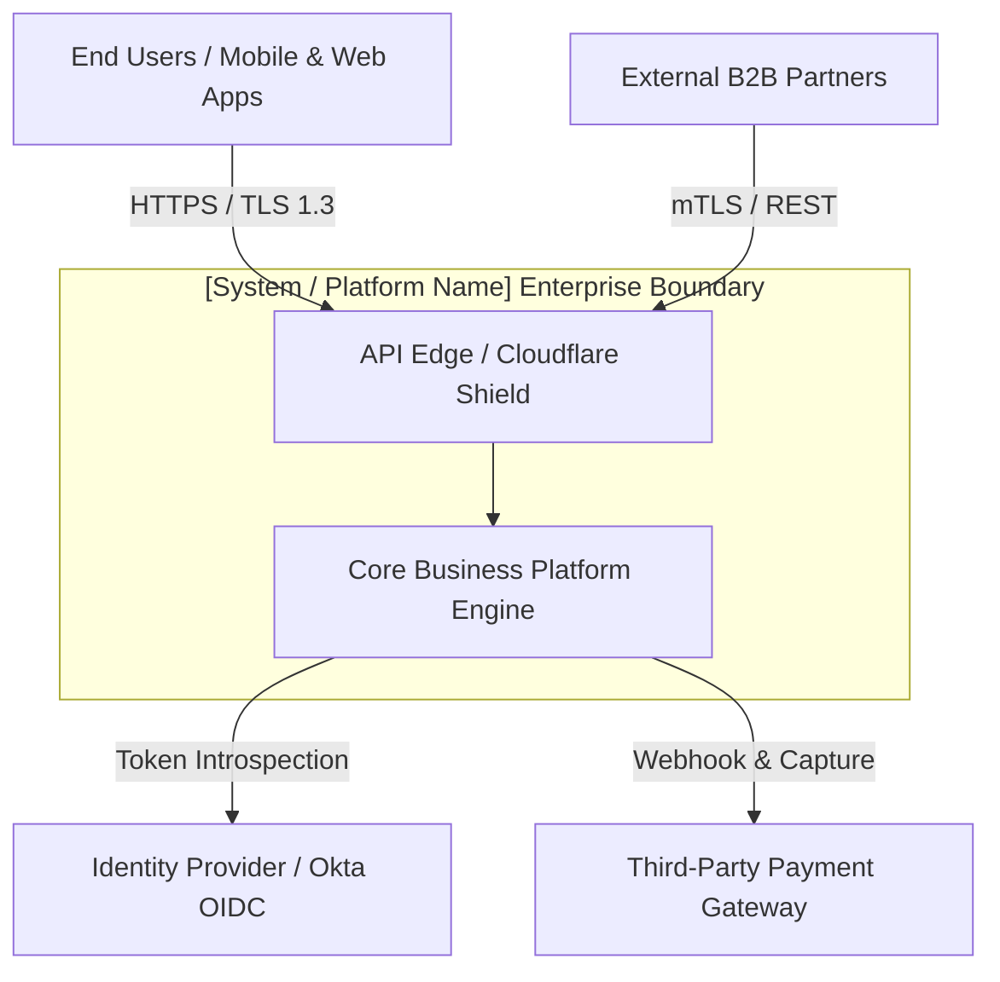
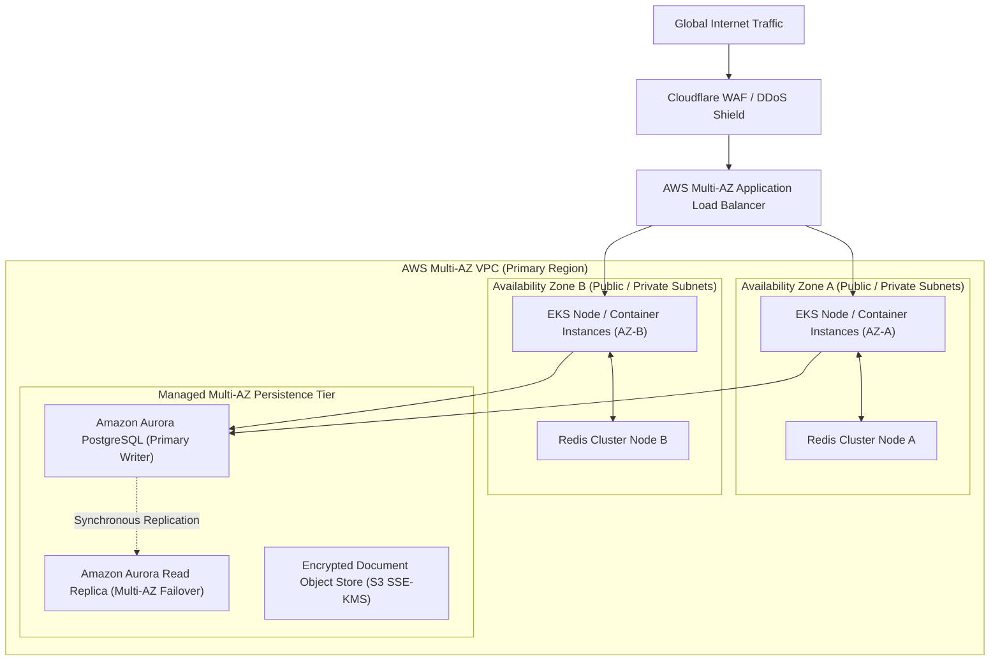

# High-Level Design (HLD) Template: [System / Platform Name]

> **Document Status:** Draft | In Review | Approved | Deprecated  
> **Target Release:** v1.0.0  
> **Authors:** [Lead Architect, Staff Engineer]  
> **Reviewers:** [Enterprise Architecture Board, Security Lead, Principal DevOps]  
> **Last Updated:** [YYYY-MM-DD]

---

## 1. Executive Summary & Business Context

### 1.1 Problem Statement
Provide a concise 1-2 paragraph description of the business problem, current bottlenecks, technical limitations, or market opportunities driving this architectural initiative.

### 1.2 Proposed Solution & Objectives
Summarize the proposed system architecture, key capabilities delivered, and how this addresses the problem statement.

### 1.3 Business & Operational Success Metrics (KPIs)
| Metric | Baseline | Target Goal | Measurement Frequency |
| :--- | :--- | :--- | :--- |
| **Transaction Throughput** | 500 RPS | 10,000 RPS | Continuous (Datadog/CloudWatch) |
| **P99 API Latency** | 850 ms | < 120 ms | Continuous |
| **System Availability** | 99.5% | 99.99% (Four Nines) | Monthly SLA Review |
| **Infrastructure Unit Cost**| $0.04 / order | < $0.008 / order | Monthly FinOps audit |

---

## 2. Scope & Boundaries

### 2.1 In-Scope Capabilities
- List functional capabilities explicitly addressed in this design.
- Core domain aggregates and workflow orchestrations.

### 2.2 Out-of-Scope Capabilities
- Capabilities deferred to subsequent phases or other external initiatives.

---

## 3. Requirements & Constraints

### 3.1 Key Functional Requirements
- **FR-01:** System must ingest incoming events with at-least-once delivery semantics.
- **FR-02:** System must provide real-time state lookup with idempotency guarantees.

### 3.2 Non-Functional Requirements (NFRs)
- **Scalability:** Must sustain peak loads up to 25,000 concurrent requests without error rate degradation exceeding 0.01%.
- **Availability & SLA:** 99.99% availability (< 52.6 minutes unscheduled downtime annually).
- **RTO & RPO:** Recovery Time Objective (RTO) ≤ 15 minutes; Recovery Point Objective (RPO) ≤ 1 minute.
- **Security & Compliance:** Compliance with SOC2 Type II, PCI-DSS Level 1, and GDPR. All sensitive payloads encrypted at rest using AES-256-GCM.

---

## 4. System Context & External Actors (C4 Level 1)

---

## 5. Architectural Topology & Deployment Infrastructure (C4 Level 2)

---

## 6. Service & Component Decomposition

| Service Name | Primary Responsibilities | Tech Stack / Framework | Data Store | Communication |
| :--- | :--- | :--- | :--- | :--- |
| **API Ingress Gateway** | Authentication, Rate Limiting, Request Validation | Go / Envoy | Redis | HTTP/2, REST |
| **Order Processing Domain** | Core transaction state, business invariants | Java / Spring Boot | PostgreSQL (Aurora) | gRPC, Kafka |
| **Notification Engine** | Async customer messaging, webhook dispatch | Node.js / TypeScript | MongoDB | Kafka Consumer |

---

## 7. Data Architecture & Persistence Strategy

### 7.1 Polyglot Persistence Model
- **Relational Transactions:** PostgreSQL with ACID compliance for order ledger and financial audit logs.
- **Distributed Cache:** Redis cluster for session states and frequently queried catalog items.
- **Event Streaming:** Apache Kafka for domain events, audit trails, and CDC replication.

### 7.2 Data Lifecycle & Retention
- Operational records: 90 days hot tier in Aurora.
- Long-term archival: Compressed Parquet in AWS S3 Glacier with automated lifecycle expiration (7 years retention).

---

## 8. Security, Identity & Trust Zones

### 8.1 Network Boundaries
- **Public Zone:** Cloudflare Edge and Load Balancers with strict TLS 1.3 termination.
- **DMZ / Ingress Subnet:** Reverse proxies and gateway nodes without direct DB access.
- **Private Subnet:** Business microservices isolated in VPC private subnets; egress through NAT Gateway.
- **Restricted Data Zone:** Database clusters accessible exclusively by authorized security groups on port 5432.

### 8.2 Authentication & Authorization
- **Authentication:** OAuth2 / OpenID Connect (OIDC) JWT tokens issued by enterprise Identity Provider.
- **Authorization:** Role-Based Access Control (RBAC) and Attribute-Based Access Control (ABAC) verified at gateway and domain boundaries.

---

## 9. High Availability, Disaster Recovery & Resilience

- **Multi-AZ Redundancy:** Automatic health-check-driven failover across 3 Availability Zones.
- **Circuit Breakers & Retries:** Resilient outbound HTTP calls utilizing exponential backoff with jitter and circuit breakers opening at 50% error rate.
- **Dead Letter Queues (DLQ):** Unprocessable asynchronous messages routed to DLQ with monitoring alarms after 3 failed delivery attempts.

---

## 10. Observability & SRE Strategy

- **Distributed Tracing:** OpenTelemetry instrumentation injected via W3C Trace Context headers.
- **Log Aggregation:** Structured JSON logging shipped to centralized SIEM / OpenSearch.
- **Alerting & Golden Signals:** PagerDuty escalation on error rate > 0.1%, latency P99 > 300ms, or CPU > 80%.

---

## 11. Architecture Decision Records (ADRs) Summary

| ADR ID | Decision Title | Status | Primary Rationale |
| :--- | :--- | :--- | :--- |
| **ADR-001** | Selection of PostgreSQL over NoSQL | Accepted | Need strict ACID transactions and foreign key constraints for financial ledger. |
| **ADR-002** | Event-Driven Architecture with Kafka | Accepted | Decouples read/write workloads and supports event replay for analytics. |

---

## 12. Risks, Assumptions & Dependencies

| Type | Description | Impact | Mitigation Strategy |
| :--- | :--- | :--- | :--- |
| **Risk** | Dependency on third-party payment gateway latency | High | Asynchronous webhook fulfillment and local fallback authorization cache. |
| **Assumption** | Inbound network traffic remains under 50,000 RPS in Year 1 | Medium | Elastic auto-scaling pods with provisioned concurrency. |
| **Dependency** | Corporate SSO integration timeline | High | Mock OIDC token generator implemented for dev/staging environments. |

