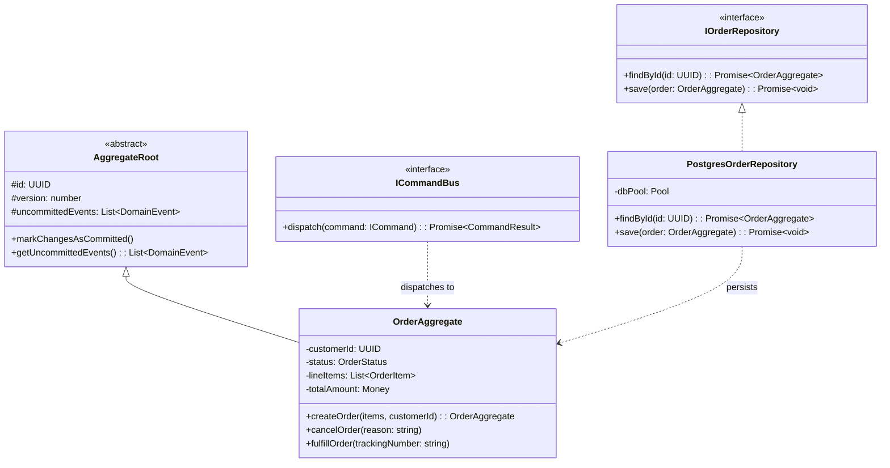
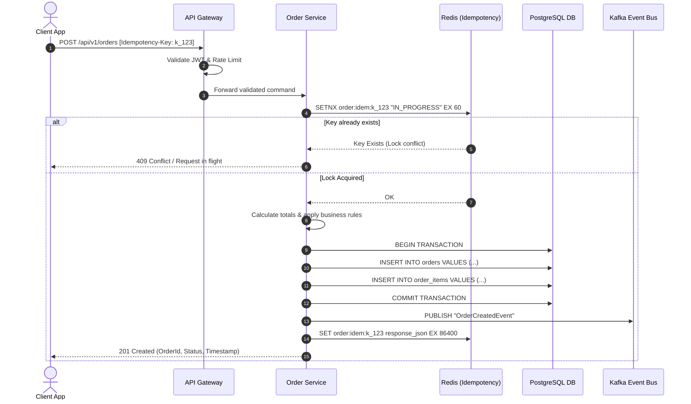
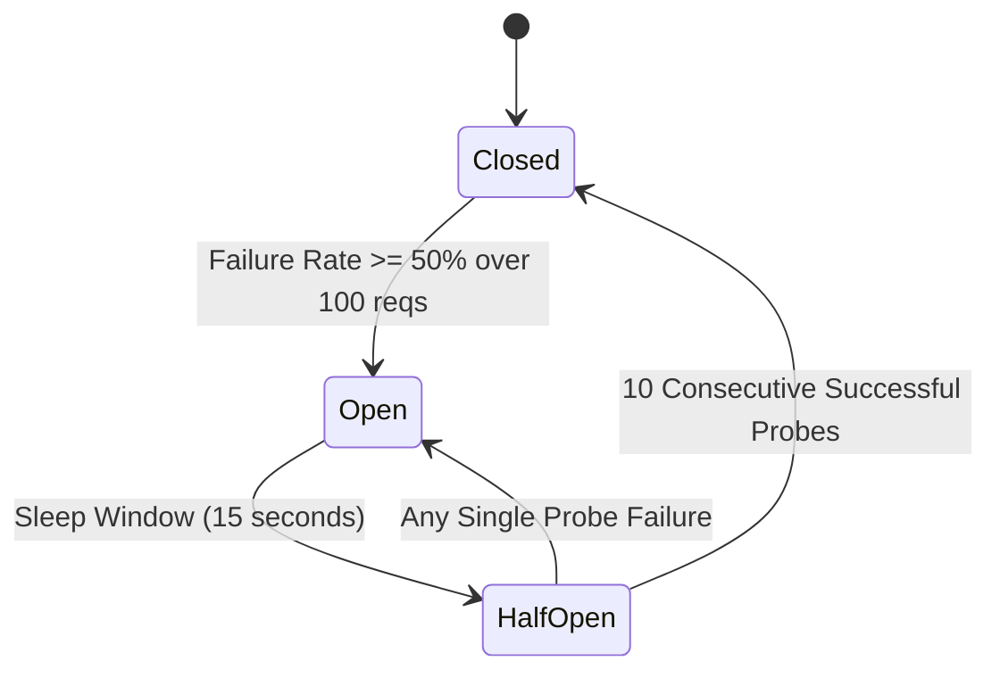

# Low-Level Design (LLD) Template: [Component / Service Name]

> **Document Status:** Draft | In Review | Approved  
> **Parent HLD:** [Link to Parent HLD / Architecture Spec]  
> **Lead Developer / Author:** [Author Name]  
> **Language & Framework:** [e.g. Node.js TypeScript / Next.js / Java Spring Boot / Go]  
> **Last Updated:** [YYYY-MM-DD]

---

## 1. Module & Directory Structure

```text
src/
├── api/
│   ├── controllers/          # HTTP Request handling & parameter parsing
│   ├── middlewares/          # Auth, Rate Limiting, Request Validation
│   └── routes.ts             # Route definitions & OpenAPI tags
├── domain/
│   ├── models/               # Domain Entities & Value Objects (Rich Domain)
│   ├── events/               # Domain Event definitions
│   └── exceptions/           # Domain-specific business exceptions
├── services/
│   ├── command-service.ts    # Application Service executing write transactions
│   └── query-service.ts      # Read model projections & caching
├── repositories/
│   ├── i-repository.ts       # Repository Interface decoupling DB
│   └── postgres-repo.ts      # Concrete SQL repository implementation
└── infra/
    ├── event-bus.ts          # Kafka / RabbitMQ publisher
    └── telemetry.ts          # OpenTelemetry spans & Prometheus metrics
```

---

## 2. Class, Interface & Component Model



---

## 3. Database Schema & DDL Specification

```sql
-- Main Domain Entity Table
CREATE TABLE orders (
    id UUID PRIMARY KEY DEFAULT gen_random_uuid(),
    tenant_id UUID NOT NULL,
    customer_id UUID NOT NULL,
    order_status VARCHAR(32) NOT NULL DEFAULT 'PENDING',
    currency CHAR(3) NOT NULL DEFAULT 'USD',
    subtotal_cents BIGINT NOT NULL CHECK (subtotal_cents >= 0),
    tax_cents BIGINT NOT NULL DEFAULT 0 CHECK (tax_cents >= 0),
    total_cents BIGINT NOT NULL CHECK (total_cents >= 0),
    idempotency_key VARCHAR(128) NOT NULL,
    version INT NOT NULL DEFAULT 1, -- Optimistic locking
    created_at TIMESTAMPTZ NOT NULL DEFAULT CURRENT_TIMESTAMP,
    updated_at TIMESTAMPTZ NOT NULL DEFAULT CURRENT_TIMESTAMP,
    CONSTRAINT uq_tenant_idempotency UNIQUE (tenant_id, idempotency_key)
);

-- Child Entity: Order Line Items
CREATE TABLE order_items (
    id UUID PRIMARY KEY DEFAULT gen_random_uuid(),
    order_id UUID NOT NULL REFERENCES orders(id) ON DELETE CASCADE,
    sku VARCHAR(64) NOT NULL,
    quantity INT NOT NULL CHECK (quantity > 0),
    unit_price_cents BIGINT NOT NULL CHECK (unit_price_cents >= 0),
    created_at TIMESTAMPTZ NOT NULL DEFAULT CURRENT_TIMESTAMP
);

-- Composite Indexes for High-Velocity Queries
CREATE INDEX idx_orders_tenant_status ON orders (tenant_id, order_status, created_at DESC);
CREATE INDEX idx_orders_customer ON orders (customer_id, created_at DESC);
CREATE INDEX idx_order_items_order_id ON order_items (order_id);
```

---

## 4. API Endpoint Contract (REST / OpenAPI Specification)

### 4.1 `POST /api/v1/orders` — Create Order
- **Headers:**
  - `Content-Type: application/json`
  - `Authorization: Bearer <JWT>`
  - `Idempotency-Key: <UUIDv4>` (Required)
- **Request Payload:**
```json
{
  "customerId": "8f1a23e4-5678-4321-abcd-ef0123456789",
  "currency": "USD",
  "items": [
    {
      "sku": "SKU-PRO-MAX",
      "quantity": 2,
      "unitPriceCents": 129900
    }
  ],
  "shippingAddress": {
    "street": "100 Innovation Way",
    "city": "Austin",
    "state": "TX",
    "zip": "78701",
    "country": "USA"
  }
}
```

- **Response Status Codes:**
  - `201 Created`: Order successfully placed.
  - `400 Bad Request`: Payload validation error (RFC 7807 problem details).
  - `409 Conflict`: Idempotency key reused with mismatched payload.
  - `422 Unprocessable Entity`: Business invariant failed (e.g. out of inventory).
  - `503 Service Unavailable`: Downstream payment gateway unreachable.

---

## 5. Detailed Execution Sequence & Interaction Flow



---

## 6. Concurrency & Optimistic Locking Strategy

To prevent race conditions during concurrent modifications:
1. Every write checks `version = :expectedVersion`.
2. Execution:
   ```sql
   UPDATE orders 
   SET order_status = :newStatus, version = version + 1, updated_at = NOW()
   WHERE id = :id AND version = :expectedVersion;
   ```
3. If rows affected == 0, throws `OptimisticLockingException` which triggers automatic retry up to 3 times with exponential backoff before bubbling up a 409 Conflict error.

---

## 7. Resilience, Retries & Circuit Breaker Policies



### Exponential Backoff with Decorrelated Jitter:
$$\text{sleep} = \min(\text{cap}, \text{random}(\text{base}, \text{previous\_sleep} \times 3))$$
- **Base:** 100ms
- **Cap:** 2,000ms
- **Max Retries:** 3 attempts
- **Timeout Budget:** Outbound calls strictly capped at 2,500ms.

---

## 8. Error Handling & Standardized Response Schemas

All non-2xx responses adhere to **RFC 7807 (Problem Details for HTTP APIs)**:
```json
{
  "type": "https://api.example.com/errors/inventory-exhausted",
  "title": "Inventory Exhausted",
  "status": 422,
  "detail": "SKU-PRO-MAX has only 1 unit remaining; requested 2.",
  "instance": "/api/v1/orders/8f1a23e4",
  "invalidParams": [
    {
      "name": "items[0].quantity",
      "reason": "Exceeds available allocation (1)"
    }
  ],
  "traceId": "trace_7b19a842f1b0"
}
```

---

## 9. Telemetry & Observability Instrumentation

- **OpenTelemetry Spans:**
  - `orders.create_order`: Root span covering entire execution.
  - `db.query`: Sub-span recording PostgreSQL statement execution duration.
  - `kafka.publish`: Sub-span recording event delivery acknowledgement.
- **Prometheus Metrics:**
  - `order_creations_total{status="success|failure"}`: Counter
  - `order_processing_latency_seconds`: Histogram with buckets `[0.05, 0.1, 0.25, 0.5, 1, 2.5]`

