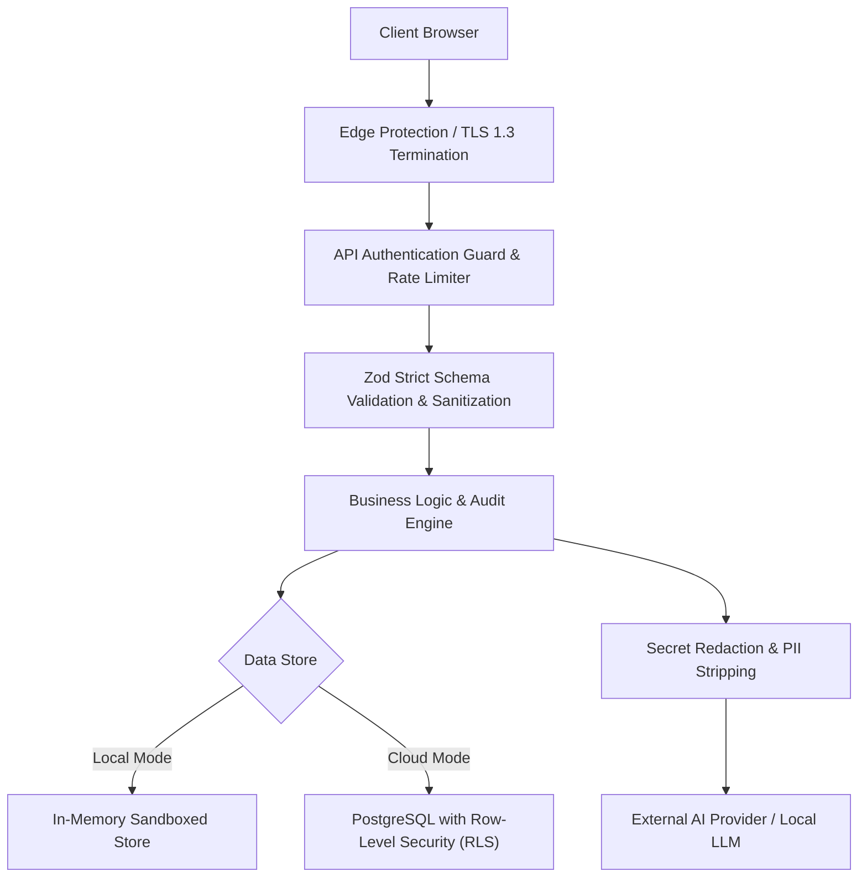

# IT Architecture Studio — Security & Compliance Architecture

## 1. Security Architecture & Threat Model

The Architecture Studio handles mission-critical enterprise design documents, technical topologies, and infrastructure specifications. The security architecture is built on the principle of **Defense-in-Depth** and **Least Privilege**.

---

## 2. Authentication & Credential Protection

### 2.1 Password Security
User passwords are treated with enterprise cryptographic standards:
- **Hashing Algorithm:** PBKDF2 with SHA-512.
- **Iterations:** 100,000 rounds.
- **Salt:** 16 bytes of cryptographically secure random entropy generated via `crypto.randomBytes(16)`.
- **Timing Attack Mitigation:** Password verification uses `crypto.timingSafeEqual` to eliminate timing side-channel attacks.

### 2.2 Account Lockout Policy
To prevent brute-force attacks against user credentials:
- Accounts are temporarily locked for **15 minutes** after **5 consecutive failed login attempts**.
- Reset tokens expire after **1 hour** and are single-use.

---

## 3. API Key & Machine Authentication

### 3.1 Scoped API Keys
For CI/CD automated documentation generation and external tool integration:
- API keys are prefixed (`docarch_...`) for automated secret-scanning detection.
- Keys are stored in the database exclusively as SHA-256 hashes (`key_hash`). Plaintext keys are presented once upon generation and never persisted.
- Each key has defined scope boundaries (`projects:read`, `projects:write`, `audit:execute`).

### 3.2 Authorization Guard (`src/lib/api-auth.ts`)
The `apiAuthGuard` middleware intercepts all incoming requests to enforce:
1. Valid session token or active API key.
2. Required role permissions (`admin` required for user/role management).
3. Graceful fallback to local sandbox mode when deployed in standalone mode.

---

## 4. Input Sanitization & XSS Mitigation

### 4.1 Strict Schema Validation
All API endpoints validate incoming JSON payloads using **Zod schemas** before any application service executes. Extraneous or malicious parameters are rejected with `400 Bad Request`.

### 4.2 Content Sanitization
- Architecture documents and ADRs support Markdown, but script execution within markdown rendering is disabled.
- Mermaid diagrams are parsed and rendered strictly via Mermaid's vector sandbox, preventing arbitrary DOM injection.

---

## 5. Secret Protection & AI Data Privacy

### 5.1 Pre-Flight Secret Redaction
When communicating with external AI providers (OpenAI, Google Gemini, Anthropic):
- Sensitive patterns matching database connection strings (`postgres://`, `mongodb://`), AWS access keys (`AKIA...`), and private keys are scrubbed before payload dispatch.
- Architecture data is never used to train public foundation models when utilizing commercial API tiers.

### 5.2 Modeling vs. Execution Isolation
The **Architecture Workflow Designer** models system logic, triggers, and rollback compensations as pure data structures. It strictly forbids executing arbitrary shell commands, OS binaries, or unsanitized code snippets on the hosting server.

---

## 6. Database Isolation & Row-Level Security (RLS)

In PostgreSQL / Supabase deployments:
- Every table enforces **PostgreSQL Row-Level Security (`ENABLE ROW LEVEL SECURITY`)**.
- Policies restrict `SELECT`, `INSERT`, `UPDATE`, and `DELETE` operations so that users can only access projects and artifacts belonging to their authenticated `user_id` or explicitly shared organization teams.
- Liquibase migration `liquibase/changesets/008-create-architecture-artifacts.sql` automatically establishes foreign key constraints with `ON DELETE CASCADE` on child entities to prevent dangling orphan data.
- Liquibase migration `liquibase/changesets/010-add-auth-verification-and-notifications.sql` ensures that `auth_tokens`, `phone_verifications`, `notification_logs`, and `usage_counters` are server-only tables accessible strictly by service-role credentials and never directly by client browsers.

---

## 7. Auth Token Cryptography & Verification Security

### 7.1 Cryptographic Token Generation & Storage
- **High-Entropy Tokens:** Email verification and password reset tokens are generated using 32 cryptographically secure random bytes (`generateSecureToken(32)` yielding 64-character hex strings).
- **Zero Plaintext Persistence:** Plaintext tokens are sent only once in the email action link and are **never stored in the database**. The database exclusively persists the SHA-256 digest (`token_hash`) of the token.
- **Single-Use Enforcement:** Tokens are stamped with `used_at` upon consumption, immediately invalidating them from any subsequent reuse attempts.
- **Strict Lifetimes:** Verification tokens expire after 24 hours; password reset tokens expire after 30 minutes.

### 7.2 Anti-Enumeration & Timing Equalization
- **Non-Enumerating Forgot-Password:** The `/api/auth/forgot-password` endpoint returns an identical positive message regardless of whether an account exists.
- **Timing Equalization:** When an email does not exist, an artificial delay ensures the response takes at least 120ms, matching the execution time of PBKDF2/cryptographic hashing to neutralize timing side-channel attacks.

### 7.3 Multi-Session Revocation on Password Change
- Upon successful password reset via `/api/auth/reset-password`, the system updates the PBKDF2 password hash, consumes the reset token, invalidates any outstanding reset tokens for the user, and revokes **all existing active sessions** across all devices (`dbRevokeUserSessions`), forcing re-authentication.

### 7.4 Sensitive Action Authorization Guards
- Unverified users may log in to review draft documents, but are strictly blocked (`403 Forbidden`) from destructive and sensitive operations (such as permanently deleting architecture projects or deleting ADRs) via `isUserEmailVerified()` checks.

---

## 8. SMS & Notification Cost Protection Guards

### 8.1 Hard Caps & Threshold Warnings
To safeguard against budget depletion and runaway send loops:
- **Email Daily Cap:** 180 sends/day (comfortably below SMTP2GO's 200/day tier limit).
- **Email Monthly Cap:** 900 sends/month (below SMTP2GO's 1,000/month tier limit).
- **SMS Daily Cap:** 50 sends/day across the organization.
- **SMS Per-User Cap:** 5 sends/day per individual user account.
- **SMS Per-IP Cap:** 10 sends/day per IP address to counter bot registration attacks.
- **80% Proactive Warning:** System emits proactive log warnings whenever usage crosses 80% of any daily or monthly cap.

### 8.2 Security Email Prioritization
When daily email volume reaches or exceeds 95% of capacity:
- Low-priority notifications (document export alerts, audit completion, ADR status updates) are deferred or dropped with audit logging.
- High-priority security emails (account verification, password reset, password changed confirmation) are always granted exclusive delivery access.

### 8.3 SMS Rate Limits & Cloudflare Turnstile CAPTCHA Hook
- **60-Second Cooldown:** SMS OTP requests require at least 60 seconds between resends per user.
- **5-Attempt Limit:** Verification IDs expire after 5 incorrect OTP attempts or 10 minutes.
- **Cloudflare Turnstile CAPTCHA:** Configurable bot protection hook (`TURNSTILE_SECRET_KEY`) verifies human attendance before triggering SMS delivery.
- **No Automatic OTP Retries:** OTP delivery errors are never retried automatically to prevent duplicate provider charges.

### 8.4 Production Environment Safeguards
- In local development, `ConsoleMailer` and `ConsoleSmsSender` log emails and OTP codes directly to the terminal.
- If deployed to production (`NODE_ENV === "production"`) without configured external provider credentials, console fallback implementations throw a runtime exception to prevent accidental silent drops.

