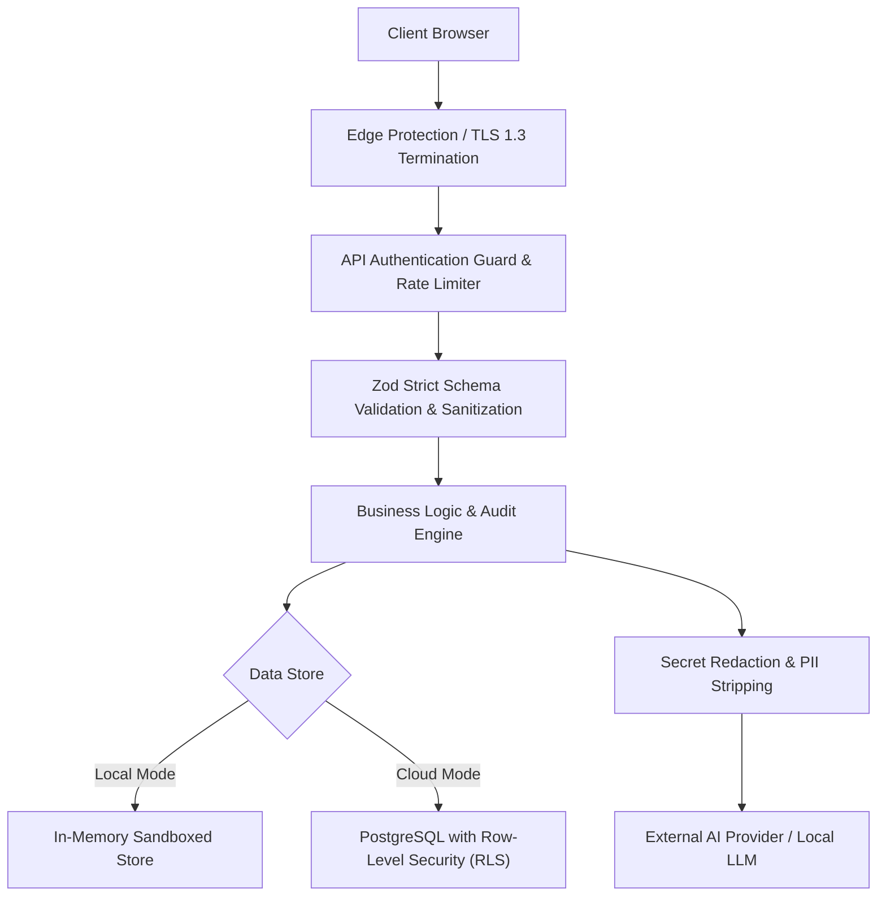

# IT Architecture Studio — Security & Compliance Architecture

## 1. Security Architecture & Threat Model

The Architecture Studio handles mission-critical enterprise design documents, technical topologies, and infrastructure specifications. The security architecture is built on the principle of **Defense-in-Depth** and **Least Privilege**.

---

## 2. Authentication & Credential Protection

### 2.1 Password Security
User passwords are treated with enterprise cryptographic standards:
- **Hashing Algorithm:** PBKDF2 with SHA-512.
- **Iterations:** 100,000 rounds.
- **Salt:** 16 bytes of cryptographically secure random entropy generated via `crypto.randomBytes(16)`.
- **Timing Attack Mitigation:** Password verification uses `crypto.timingSafeEqual` to eliminate timing side-channel attacks.

### 2.2 Account Lockout Policy
To prevent brute-force attacks against user credentials:
- Accounts are temporarily locked for **15 minutes** after **5 consecutive failed login attempts**.
- Reset tokens expire after **1 hour** and are single-use.

---

## 3. API Key & Machine Authentication

### 3.1 Scoped API Keys
For CI/CD automated documentation generation and external tool integration:
- API keys are prefixed (`docarch_...`) for automated secret-scanning detection.
- Keys are stored in the database exclusively as SHA-256 hashes (`key_hash`). Plaintext keys are presented once upon generation and never persisted.
- Each key has defined scope boundaries (`projects:read`, `projects:write`, `audit:execute`).

### 3.2 Authorization Guard (`src/lib/api-auth.ts`)
The `apiAuthGuard` middleware intercepts all incoming requests to enforce:
1. Valid session token or active API key.
2. Required role permissions (`admin` required for user/role management).
3. Graceful fallback to local sandbox mode when deployed in standalone mode.

---

## 4. Input Sanitization & XSS Mitigation

### 4.1 Strict Schema Validation
All API endpoints validate incoming JSON payloads using **Zod schemas** before any application service executes. Extraneous or malicious parameters are rejected with `400 Bad Request`.

### 4.2 Content Sanitization
- Architecture documents and ADRs support Markdown, but script execution within markdown rendering is disabled.
- Mermaid diagrams are parsed and rendered strictly via Mermaid's vector sandbox, preventing arbitrary DOM injection.

---

## 5. Secret Protection & AI Data Privacy

### 5.1 Pre-Flight Secret Redaction
When communicating with external AI providers (OpenAI, Google Gemini, Anthropic):
- Sensitive patterns matching database connection strings (`postgres://`, `mongodb://`), AWS access keys (`AKIA...`), and private keys are scrubbed before payload dispatch.
- Architecture data is never used to train public foundation models when utilizing commercial API tiers.

### 5.2 Modeling vs. Execution Isolation
The **Architecture Workflow Designer** models system logic, triggers, and rollback compensations as pure data structures. It strictly forbids executing arbitrary shell commands, OS binaries, or unsanitized code snippets on the hosting server.

---

## 6. Database Isolation & Row-Level Security (RLS)

In PostgreSQL / Supabase deployments:
- Every table enforces **PostgreSQL Row-Level Security (`ENABLE ROW LEVEL SECURITY`)**.
- Policies restrict `SELECT`, `INSERT`, `UPDATE`, and `DELETE` operations so that users can only access projects and artifacts belonging to their authenticated `user_id` or explicitly shared organization teams.
- Liquibase migration `liquibase/changesets/008-create-architecture-artifacts.sql` automatically establishes foreign key constraints with `ON DELETE CASCADE` on child entities to prevent dangling orphan data.

