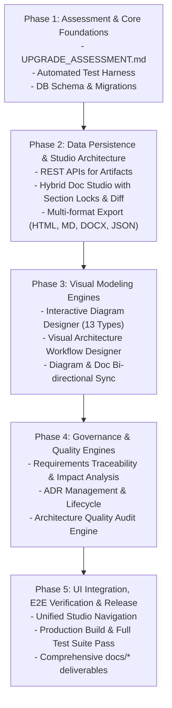

# Upgrade Assessment & Implementation Blueprint
## IT Common Documentation & Architecture Studio (DocArch AI)

**Assessment Date:** October 2026  
**Target Repository:** `ravi-kundu7284/it-common-doc-arch-stdio-app`  
**Target Branch:** `feature/intial-dev-arch-stdio`  
**Evaluation Perspective:** Enterprise IT Architect, Lead Software Engineer, DevOps Architect, UX/UI Lead  

---

## 1. Executive Summary

This assessment provides a comprehensive technical audit of the current **DocArch AI** repository, evaluating existing architecture, features, security, persistence, testing, developer experience, and operational readiness. 

The application currently serves as an AI-powered technical design document generator with a 3-step intake wizard (Requirements Intake, Architecture Pattern Recommender, and Document Studio with live split-screen preview). However, enterprise production readiness requires upgrading this foundation into a full-lifecycle **IT Architecture & Documentation Studio** that delivers:
1. Interactive visual diagramming with persistence, lifecycle tracking, and embedding.
2. Architecture process workflow modeling with validation and failure-path logic.
3. Requirements traceability and automated change-impact analysis.
4. Comprehensive Architecture Decision Records (ADR) governance.
5. Automated deterministic and heuristic architecture quality audits.
6. Multi-format export (HTML, Markdown, PDF, DOCX, JSON/YAML).
7. Relational database schema expansions with Liquibase/Supabase migrations for all architecture entities.
8. Comprehensive automated test coverage (unit, integration, regression).

---

## 2. Technology Stack & Baseline Review

| Tier | Current Technology | Status & Assessment | Recommendation |
| :--- | :--- | :--- | :--- |
| **Frontend Framework** | Next.js 14.0.4 (App Router) | Working cleanly with React 18, TypeScript 5.4.5 | Maintain Next.js 14 App Router, optimize client/server boundaries. |
| **Styling & UI** | Tailwind CSS 3.4.3 + Typography + Lucide Icons | Dark-themed, modern responsive layout | Enhance design system with consistent navigation, tabs, modals, and light/dark theme support. |
| **State Management** | Zustand 4.5.2 (LocalStorage persist) | Functional for client-side document edits; lacks synchronization with backend database | Maintain Zustand store, integrate bi-directional sync with REST APIs & database. |
| **Diagrams** | Mermaid.js 10.9.1 (SVG client rendering) | Pure text-to-SVG viewer; lacks interactive visual node editing | Add Interactive Diagram Designer supporting visual node/connector editing, lifecycle CRUD, and text-based Mermaid synchronization. |
| **Database & ORM** | PostgreSQL (Supabase JS 2.117.2 + In-Memory Fallback) | Only user accounts, AI configs, and sessions are in DB; projects, diagrams, ADRs, workflows are client-only | Expand PostgreSQL schema with tables for Projects, Documents, Revisions, Diagrams, Workflows, Requirements, ADRs, and Quality Audits; provide dual-mode Supabase/Sandbox support. |
| **Database Migrations** | Liquibase 4.27.0 XML + SQL Changesets | Only changesets 000-007 exist for auth & user accounts | Add Liquibase changesets and Supabase SQL migrations for all new architectural entities. |
| **AI Integration** | Vercel AI SDK (`ai` 3.1.20, `@ai-sdk/openai`, `@ai-sdk/google`) | Basic section refinement and generation; fallback rule-based synthesis works offline | Maintain dual-mode AI engine: real AI via Google/OpenAI/Anthropic when keys are provided, plus high-fidelity built-in synthesis for zero-config/offline execution. |
| **Testing** | None (no test runner configured) | Only 1 manual DB test script exists | Add automated test suite with unit, integration, and regression tests. |
| **Linting & CI/CD** | `next lint` fails due to missing `.eslintrc.json` | Missing ESLint package and configuration | Configure ESLint and CI validation pipeline. |

---

## 3. Detailed Gap Analysis

### 3.1 Current Capabilities
- **Guided Requirements Intake Wizard**: Project basics, scale (RPS, users, retention), SLAs, compliance, constraints, and 4 industry presets.
- **Architecture Pattern Recommender**: Pattern scoring and comparison (Microservices, Modular Monolith, CQRS, Hexagonal, Jamstack) across 6 technology tiers.
- **Document Studio**: Split-view Markdown editor with live Mermaid preview, reorderable sections, and snippet insertion.
- **Standalone Exports**: Self-contained single-page HTML bundle with embedded Mermaid CDN script; raw Markdown export.
- **Enterprise Auth & Security**: PBKDF2 password hashing with salt, 3-attempt 2-minute lockout, AES-256-GCM encrypted API key storage with auto-expiry, and session management.

### 3.2 Missing Capabilities (Master Prompt Scope)
1. **Interactive Diagram Designer**:
   - Visual drag-and-drop node editing, connector creation, node properties, grouping, zoom/pan/minimap.
   - Support for 13 architectural diagram types (System Context, Container/Component C4, Cloud Deployment, Network Topology, UML Class, Sequence, Activity, Data Flow, ERD, BPMN Workflow, CI/CD Pipeline, Event Flow, State Machine).
   - Diagram lifecycle: create, edit, rename, duplicate, version history, export (SVG/PNG/JSON/Mermaid), import, and sync with document sections.
2. **Architecture Workflow Designer**:
   - Visual workflow modeling with triggers, tasks, human approvals, conditional branches, parallel execution, retries, timeouts, and failure/compensation paths.
   - Validation engine: unreachable steps, dangling nodes, circular loops, missing failure handlers.
   - Workflow lifecycle (Draft, Published, Archived) and dry-run execution trace simulation.
3. **Requirements Traceability & Change Impact Engine**:
   - Traceability matrix connecting Business Requirements → Functional Requirements → NFRs → Architecture Components → APIs/Data Models → Diagrams → Test Cases.
   - Change-impact detector: when a requirement changes, identify impacted components, diagrams, APIs, and document sections with proposed diff updates.
4. **Architecture Decision Records (ADR) Governance**:
   - Structured ADR management (Proposed, Accepted, Rejected, Deprecated, Superseded).
   - Context, decision drivers, options considered, trade-offs, consequences, and supersession links.
5. **Architecture Quality & Validation Engine**:
   - Rule-based deterministic auditing + AI heuristic review across HLD, LLD, and integration workflows.
   - Categorized findings with severity (Critical, High, Medium, Low), remediation recommendations, trade-offs, and remediation status.
6. **Low-Level Design (LLD) Depth**:
   - Explicit package structures, class/interface relationships, transaction boundaries, idempotency, concurrency, retry/circuit breakers, and code contracts in multiple languages.
7. **Document Formats**:
   - Rich DOCX export, structured JSON/YAML export/import, and enhanced printable PDF.
8. **Hybrid & Section-Level Editing**:
   - Section locking against AI changes, structured diff viewer before applying AI updates, version history with restoration.
9. **Durable Persistence for Architecture Artifacts**:
   - Database tables, REST APIs, and migration scripts for projects, documents, sections, revisions, diagrams, workflows, requirements, ADRs, and review findings.

---

## 4. Technical Debt, Security, and Reliability Gaps

### Technical Debt
- **Browser-only Persistence**: User projects, custom templates, and documents are stored solely in browser `localStorage`. If cache is cleared or accessed from another machine, artifacts are lost.
- **Missing Test Suite**: Zero automated tests in `package.json`. No verification that document generation, export rendering, or auth logic works across releases.
- **Linting Incomplete**: Missing `.eslintrc.json` and `eslint` dependencies prevented automated linting.

### Security & Reliability Gaps
- **Prompt Injection Defense**: When generating documents or analyzing user input, strict sanitization and validation boundaries are required.
- **Fail-Safe AI Degradation**: When AI API keys are expired, invalid, or rate-limited, editing, diagramming, and document management must remain 100% operational.
- **Optimistic Concurrency & Revision History**: Simultaneous updates risk overwriting manual edits without version tracking.

---

## 5. Prioritized Implementation Plan

### Phase Breakdown

1. **Phase 1: Foundations & Assessment (Immediate)**
   - Complete `docs/UPGRADE_ASSESSMENT.md`.
   - Setup automated test runner and initial test suite.
   - Define database schema extensions (`supabase/schema.sql` and `liquibase/changesets/008-create-architecture-artifacts.sql`).
   - Configure ESLint and verify clean compilation.

2. **Phase 2: Core Persistence & Document Studio Enhancements**
   - Add unified REST APIs for Projects, Documents, Diagrams, Workflows, Requirements, ADRs, and Audits with Supabase + Sandbox fallback.
   - Upgrade Document Studio:
     - Section locking against automated AI regeneration.
     - Visual Diff viewer for reviewing proposed AI changes before applying.
     - Document revisions and version history restoration.
     - Multi-format exports: HTML, Markdown, DOCX, JSON/YAML.

3. **Phase 3: Interactive Diagramming & Architecture Workflow Designer**
   - Build **Interactive Diagram Designer**:
     - Visual node & connector canvas with pan/zoom, grid, node properties, grouping, undo/redo.
     - Pre-configured templates for all 13 required architectural diagram types.
     - Real-time two-way synchronization between visual model and Mermaid vector source.
     - Lifecycle actions: Create, Save, Version, Export (SVG/PNG/JSON), Import, Embed into documents.
   - Build **Architecture Workflow Designer**:
     - Visual process modeling with triggers, tasks, conditionals, human approvals, parallel paths, retry/timeouts, and failure compensations.
     - Workflow validation engine (unreachable nodes, deadlocks, missing end states, missing error paths).
     - Lifecycle states (Draft, Published, Archived) and simulation trace.

4. **Phase 4: Requirements Traceability, ADRs & Quality Audit Engine**
   - Build **Requirements Traceability Registry**:
     - Business → Functional → NFR → Component → API → Diagram → Test links.
     - Automated change-impact analysis engine.
     - Visual Traceability Matrix.
   - Build **ADR Management System**:
     - Full ADR lifecycle (Proposed, Accepted, Rejected, Deprecated, Superseded).
     - Decision matrices, consequence tracking, and Markdown export.
   - Build **Architecture Quality & Validation Engine**:
     - Deterministic rule checks (SPOFs, unencrypted transport, missing SLA budgets, missing error paths).
     - Structured findings with severity, remediation, and status tracking.

5. **Phase 5: Release Verification & Documentation**
   - Run complete test suite and production build.
   - Deliver full documentation suite (`docs/ARCHITECTURE.md`, `docs/HLD_TEMPLATE.md`, `docs/LLD_TEMPLATE.md`, `docs/AI_FEATURES.md`, `docs/DIAGRAMS_AND_WORKFLOWS.md`, `docs/API.md`, `docs/SECURITY.md`, `docs/DEVELOPMENT.md`, `docs/DEPLOYMENT.md`, `CHANGELOG.md`, `README.md`).

---

## 6. Migration & Compatibility Strategy

- **Zero Breaking Changes**: All existing endpoints (`/api/generate`, `/api/auth/*`, `/api/admin/*`, `/api/user/*`) remain fully backward-compatible.
- **Client Fallback**: Zustand store automatically migrates existing `localStorage` data, ensuring users do not lose existing drafts.
- **Dual-Mode Persistence**: The repository runs seamlessly without external PostgreSQL credentials via the built-in Sandbox Database, while offering instant full-fidelity persistence when Supabase credentials are provided.
- **Deterministic AI Fallback**: If LLM API keys are unavailable or fail, all architectural synthesis, diagram generation, and quality audits fall back to the built-in synthesis rules without runtime errors.

